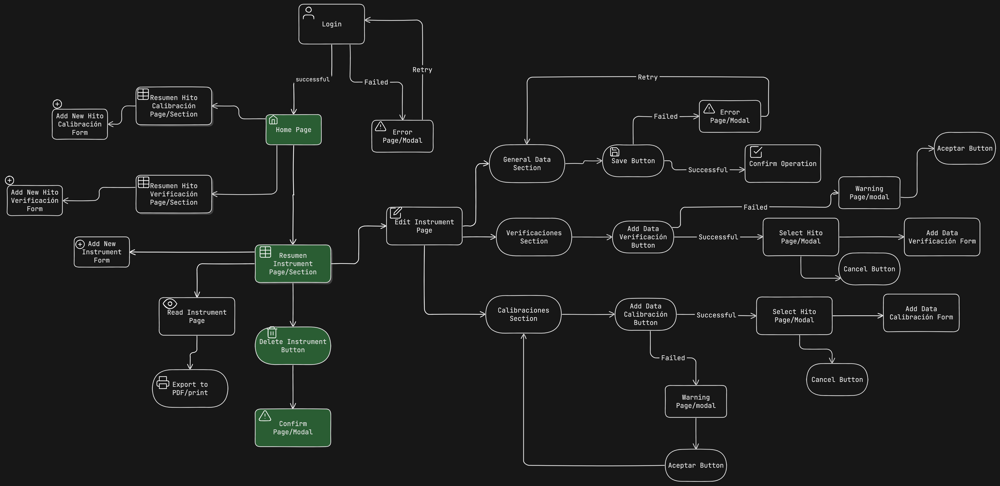

# User Stories

- [X] Como usuario quiero visualizar una tabla con todos los instrumentos y accesorios.
- [ ] Como usuario quiero visualizar una tabla con todos los hitos de verificación.
- [X] Como usuario quiero visualizar una tabla con todos los hitos de calibración.
- [ ] Como usuario quiero acceder a editar todos los detalles de los accesorios e instrumentos.
- [ ] Como usuario quiero acceder a visualizar todos los detalles de los accesorios e instrumentos.
- [X] Como usuario quiero poder agregar nuevos accesorios/instrumentos.
- [ ] Como usuario quiero poder imprimir y/o exportar en pdf los detalles de los accesorio/instrumentos.
- [ ] Como administrador quiero poder eliminar accesorios/instrumentos.
- [ ] Como administrador quiero poder crear un Hito de verificación
- [ ] Como administrador quiero poder crear un Hito de calibración.
- [ ] Como usuario quiero poder agregar información a un hito de verificación vigente.
- [ ] Como usuario quiero poder agregar información a un hito de calibración vigente.
- [ ] Como usuario quiero poder agregar y visualizar reportes e informes de verificación en pdf.
- [ ] Como usuario quiero poder agregar y visualizar certificados de calibración.

# Bugs

# Misc

- [X] Se hace necesario realizar un diagrama de flujo para ordenar distribución de componentes y páginas.

- [X] Modificar base de datos respecto a marca y modelo de instrumento/accesorio. La relación entre marca y modelo se encuentra erronea, ya que se está centralizando en el instrumento, siendo que debería generare una relación directa entre la marca y el modelo. En la tabla de modelo, el modelo debería ser una llave foranea.
  - **Action**: Se agrega una llave foranea de id_marca en la tabla de modelo, y se mantiene la fk en la tabla instrumentos.
- [X] Agregar `select` de modelo, dependiente de selecciñon de marca.
- [ ] Agregar categoría de instrumentos, si son accesorios, instrumentos u otros.
- [ ] Analizar con Pedro agregar tipo y categoría de instrumentos en el modelo.
- [ ] Histórico de creación de instrumentos, inactividad o robo, vigencia.
- [ ] Fecha de compra de instrumentos.
- [ ] Fecha de garantía en caso de ser necesario.
- [ ] Agregar num ofpa a tabla solic_calibration.
- [ ] Modificar estado_solic para se defina en razón de la solicitud no de la acción a realizar (no calibrado).
- [ ] Modificar tabla de instrumentos, para agregar lógica que permita organizar instrumentos y accesorios por "Kit", cómo Kit GNSS 1.
- [ ] Agregar categoría de instrumentos, si son accesorios, instrumentos u otros.

# Notes

## Diseño

- https://flowbite.com/docs/getting-started/quickstart/
- https://ant.design/ (este se ocupó para el proyecto)
- https://ui.shadcn.com/